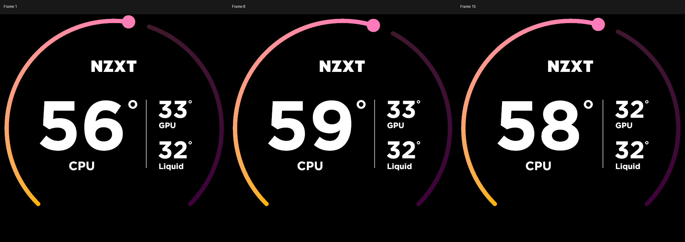
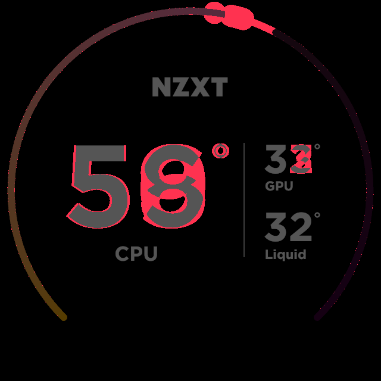

# Kraken Elite V2 investigation

This records the evidence behind the Rust application. For installation and CLI
usage, see [README.md](README.md). [The artifact index](artifacts/README.md)
explains the directory structure; the bulk original imports remain preserved
locally, including their historical notes.

## Device and verified LCD protocol

The tested device is an NZXT Kraken Elite V2, USB VID:PID **1e71:3012**, with a
640×640 LCD. The captured descriptor reports bcdDevice 0x0102, which need not
represent the complete firmware version. USB configuration:

| Interface | Type | Endpoints |
| --- | --- | --- |
| 0 | Vendor-specific | Bulk OUT `0x02`, maximum packet size 512 |
| 1 | HID | Interrupt OUT `0x01`, IN `0x81`, maximum packet size 512 |

One RGB888 frame is transmitted as:

1. Send `36 01 00 01 09`, padded to 512 bytes, on interrupt OUT.
2. Wait for `37 01` with status byte 14 equal to 1.
3. Send this separate 20-byte bulk header:

   ```text
   12 fa 01 e8 ab cd ef 98 76 54 32 10 09 00 00 00 00 c0 12 00
   ```

4. Send 1,228,800 bytes: 640 × 640 × 3 raw RGB888 pixels.
5. Send `36 02`, padded to 512 bytes, and wait for successful `37 02`.

Header offset 12 selects format; bytes 16–19 contain payload length as a
little-endian u32. Status reports can arrive between acknowledgements and must
be skipped rather than treated as the response to the current command.

Both the Python PoC and Rust implementation have successfully uploaded frames
to this hardware. The user visually confirmed the original RGB test pattern.
The implementations validate write lengths and acknowledgements and do not
replay captured cooling or lighting commands.

## Captures: truncated versus complete

[Original June capture](artifacts/captures/june/export.pcapng): 274 records over
10.193198 seconds, ten uploads at about 1 Hz. Each image URB declares 1,228,800
bytes, but the 65,535-byte capture limit retains only 65,508 payload bytes after
the USBPcap header. That is 34 complete RGB rows plus 228 bytes, about 5.33% of
the image. The fragments render as a pink arc; missing data cannot be restored
by joining prefixes belonging to different frames.

The image URBs complete in 59.41–59.85 ms, roughly 20.6 MB/s. This is a
transport-only observation, not a measured maximum LCD animation rate.

[Complete Windows capture](artifacts/captures/windows/cam-frames.pcapng): 396
records over 14.854 seconds, **15 complete RGB888 frames**, no truncated records.
Its snaplen is 2 MiB. All supplied `.bin` frames and decoded PNGs were checked
against the packet payloads. Frame submissions are 0.9980–1.0029 seconds apart.
The same mode-0x09 header is used throughout.



The displayed layout is CPU large, GPU upper-right, Liquid lower-right. Across
15 uploads there are 11 distinct rasters. Only 12,148 of 409,600 pixel locations
change at all (2.97%): principally digits and the arc endpoint/indicator, with
some subtle antialiasing differences. The logo, labels, and divider remain
identical. The liquid number stays at 32 in this sample; that does not make it
a static UI element.



Identical pixels do not prove that a bitmap was cached: redraws can produce the
same output. `invariant-pixels.png` is an analytical mask, not a complete reusable
template. [Detailed capture report](artifacts/analysis/windows/FINDINGS.md).
Capture hashes and sizes are in [the manifest](artifacts/captures/manifest.json).

## Q565 sample and transfer boundaries

The earlier decoder sample has an actual `q565` header, followed by little-endian
640×640 dimensions. [The frame](artifacts/samples/q565/frame.q565) is 10,586 bytes,
about 116× smaller than raw RGB888 for this mostly black logo. Its
[previously decoded image](artifacts/samples/q565/out.png) shows a white rounded
ring/diamond. Neither the frame nor its header appears in the supplied RGB
captures. Q565 support and mode-0x09 RGB captures are compatible findings.

The decoder calls `Q565DecodeContext::decode::<LittleEndian>` with RGB888 output.
Its original repository is preserved locally under `artifacts/local/q565-decoder`.
The existing PNG was inspected; the initial offline reconstruction attempt was
blocked by an uncached dependency.

The community [AIOLCDUnchained driver](https://github.com/brokenmass/AIOLCDUnchained/blob/main/driver.py)
uses `36 01 00 01 08`, puts `08` at bulk-header offset 12, sends a length-delimited
Q565 frame, then finishes with `36 02`. Both uploaders implement that framing
for existing files, but Q565 upload is still experimental and was not tested on
the hardware here. Header checks do not validate the full compressed stream.

A frame, host transfer/URB, and individual USB bus packet are different
boundaries. One large URB comprises many bus packets; applications may also
split a frame over multiple writes. The June problem is capture truncation of
URBs, not evidence that remaining bytes exist in later captured records.

## CAM renderer evidence

Static analysis of the standalone Electron executable found runtime Vulkan
strings and one valid 256×256 NZXT PNG, but no complete dashboard template.
The additional installation resources supplied the relevant native module:
`artifacts/local/cam-installation/resources/app.asar.unpacked/node_modules/@nzxt/cam-core/dist/index.node`.

The application identifies itself as CAM 4.76.9 with cam-core 71.9.4. Evidence:

- JavaScript defaults `forcedGraphicsApi` to Vulkan and passes it to CoreClient.
- LCD configuration calls `LcdApi.renderGraphic` in the native core.
- Embedded Rust paths identify wgpu 23.0.1, naga 23.0.0, `triple_infographic.rs`,
  `single_infographic_arc.rs`, and `kraken_rendering/send_to_device.rs`.
- Fourteen readable WGSL shaders were recovered, including radial gauge,
  indicator, glyph-atlas text, image overlay, clockface and other renderers.
- The radial shader samples a gradient by angular progress and lowers opacity
  past `reading_normalized`. The indicator samples that gradient at the reading.
- Triple-reading configuration passes sensor selection, labels, colors,
  gradient stops, logo configuration, and a 5% inactive-arc opacity on Elite
  models. Layout geometry and other parameters remain compiled Rust code.
- Embedded Gotham Bold and Light OpenType fonts were recovered and parsed with
  FreeType. The Rust dashboard can select a local font with `--font`.

This supports a native GPU renderer with Vulkan as the configured default,
not just generic Vulkan support in Electron. It does not prove which backend
the running Windows process selected or provide a full execution trace.
The extracted shaders have not been compiler-validated; boundaries were recovered
from readable source runs, adjacent labels, and brace-balance checks.
[Detailed resource findings](artifacts/analysis/cam/FINDINGS.md) and
[focused evidence](artifacts/analysis/cam/evidence.json) retain offsets and excerpts.
Raw executables, full bundles, recovered fonts/shaders and original imports
remain in the ignored `artifacts/local/` area, outside the Cargo package.

## Sensor sources and hardware validation

- CPU: hwmon AMD `k10temp` Tctl, or Intel `coretemp` Package id 0.
- GPU: `nvidia-smi`, explicitly selecting the NVIDIA card rather than AMD iGPU.
- Liquid: unsolicited Kraken `75 01` / `75 02` reports; byte 15 + byte 16 / 10 °C.

The temperature interpretation also appears in
[liquidctl's Kraken driver](https://github.com/liquidctl/liquidctl/blob/main/liquidctl/driver/kraken3.py).
Invalid, missing, and stale readings display `--`. CAM may choose different CPU
sensors or averaging, so exact Windows/Linux values can differ.

Rust validation covers packet framing, rejected/truncated acknowledgements,
short writes, interleaved status, sensor errors, layout permutations and CLI
validation. Live runs verified uploads, SIGTERM cleanup, device reopening, and
the shared PoC/Rust lock. `clg` and Liquid-primary `lcg` were hardware-tested.

## Reproduce the investigation

Run from the project root. Python tools are historical/reference utilities,
not runtime dependencies of the Rust binary. Analysis needs Pillow and NumPy;
USB PoC tools additionally need PyUSB. On the tested Ubuntu system these are
available to `/usr/bin/python3`.

```sh
# Truncated capture: summary, transactions, partial RGB previews
/usr/bin/python3 artifacts/scripts/analyze_capture.py
# Complete capture: validate, extract frames, compare changing pixels;
# inspect the standalone executable too when the optional local copy exists
/usr/bin/python3 artifacts/scripts/investigate_windows.py
# Optional: needs the original CAM installation in artifacts/local/
/usr/bin/python3 artifacts/scripts/extract_cam_resources.py
# USB-free PoC checks
/usr/bin/python3 artifacts/scripts/kraken_dashboard.py --preview
/usr/bin/python3 artifacts/scripts/kraken_usb.py --test-pattern --dry-run artifacts/runtime/test-pattern.rgb
```

These defaults use the reorganized paths. Complete frames regenerate into
`artifacts/analysis/windows/frames/`, which is ignored; selected figures remain
under `artifacts/figures/windows/`. Raw June prefixes are similarly regenerable.
The original Windows session scripts remain in the local archive as historical
records. The maintained Windows helper is parameterized:

```powershell
.\artifacts\scripts\capture-kraken.ps1 -Interface '\\.\USBPcap2' -DeviceAddress 16
```

Identify the interface and current USB address first. The helper captures only
that device, requests a 2 MiB snaplen, and refuses to overwrite an existing file.
It has not been rerun on Windows after parameterization. Always verify retained
length equals original length for image URBs; a large snaplen alone does not
guarantee every backend retains the full payload.

The full pre-reorganization notes and imports are preserved in `artifacts/local/`
for provenance; this document supersedes their old paths and early limitations.
