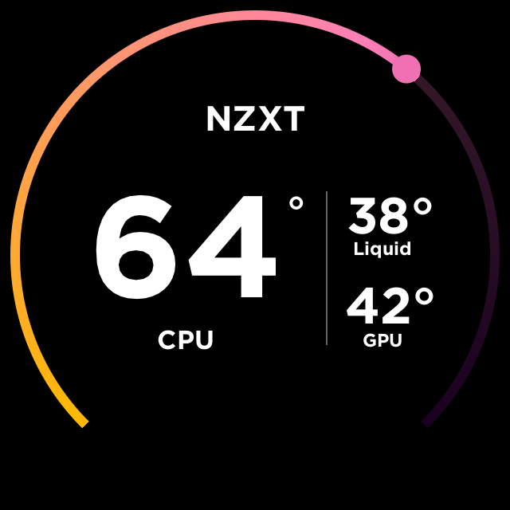

# kraken360

A Rust library and Linux CLI for displaying CPU, GPU, and coolant temperatures
on the **NZXT Kraken Elite V2** (`1e71:3012`, 640×640 LCD).



The renderer runs on the CPU and sends RGB888 frames over USB. Vulkan, Python,
and NZXT CAM are not required. It controls the LCD only; cooling profiles and
RGB lighting are unchanged. For the USB protocol, captures, Q565 experiments,
and recovered CAM rendering evidence, see [Investigation.MD](Investigation.MD).

## Requirements

- Rust 1.88+ and Cargo, a C compiler, and make. Vendored libusb is built by Cargo;
  libusb development headers do not need a separate installation.
- Linux hwmon CPU sensors: AMD `k10temp` Tctl or Intel `coretemp` Package id 0.
- NVIDIA's `nvidia-smi` for GPU readings; GPU index 0 is the default.
- A font, defaulting to Ubuntu's DejaVu Sans Bold, or a local TTF/OTF via `--font`.
- USB access to the Kraken. The tested host already has suitable permissions;
  elsewhere configure a device-specific udev rule, such as liquidctl's rules.

## Build and use

```sh
cargo build --release
./target/release/kraken360 preview
./target/release/kraken360 run --frames 5
./target/release/kraken360 run --layout clg
```

Stop any existing LCD service/controller before running `run`. Ctrl+C or SIGTERM
releases the interfaces and restores detached kernel drivers. The last frame
remains visible but stops updating. `preview` never opens USB and shows `--` for
coolant. Failed or stale readings also show `--`.

Options belong **after** `run` or `preview`:

```sh
kraken360 run --help
kraken360 preview --layout clg --output artifacts/runtime/preview.png
kraken360 run --layout cgl --interval 1 --gpu-index 0
kraken360 run --cpu-sensor /sys/class/hwmon/hwmon3/temp1_input
```

CPU sensor paths are normally discovered automatically; hwmon numbering may
change after reboot. Readings use Celsius. Default refresh is once per second.
The gauge follows the primary temperature on a 0–100°C scale. Rendering is an
approximation of the captured CAM design, not a pixel-exact clone.

## Temperature order

`--layout` gives **large reading, upper-right, lower-right**. Values, labels, and
the primary arc move together.

| Layout | Large | Upper-right | Lower-right |
| --- | --- | --- | --- |
| `gcl` (default) | GPU | CPU | Liquid |
| `glc` | GPU | Liquid | CPU |
| `cgl` | CPU | GPU | Liquid |
| `clg` | CPU | Liquid | GPU |
| `lgc` | Liquid | GPU | CPU |
| `lcg` | Liquid | CPU | GPU |

`--primary gpu` and `--primary cpu` remain aliases for `gcl` and `cgl`; do not
combine them with `--layout`.

## Install and run as a user service

```sh
install -Dm755 target/release/kraken360 "$HOME/.local/bin/kraken360"
mkdir -p "$HOME/.config/systemd/user"
cp systemd/kraken360.service "$HOME/.config/systemd/user/"
```

Ensure `~/.local/bin` is on PATH. Before enabling the service, edit its
`WorkingDirectory` to the absolute path of your checkout. The template matches
this host's `~/Documents/reversing/kraken360` location and uses the system font.

```sh
systemctl --user daemon-reload
systemctl --user enable --now kraken360
systemctl --user status kraken360
journalctl --user -u kraken360 -f
```

It starts at sign-in and restarts after failures. User lingering is not enabled
on the tested host, so this is not a pre-login boot service.

To set a persistent layout, run `systemctl --user edit --full kraken360`, change
`--layout` in `ExecStart`, then reload and restart:

```sh
systemctl --user daemon-reload
systemctl --user restart kraken360
# Stop it before a foreground hardware experiment:
systemctl --user stop kraken360
# Disable startup and stop:
systemctl --user disable --now kraken360
```

The current host's installed service retains its selected `cgl` layout and local
Gotham font at `artifacts/local/cam-resources/embedded-fonts/`. The checked-in
service does not require that font. Use the system font to run without local CAM
resources. After rebuilding, stop the service, reinstall the binary, and start
it again.

## Files, experiments, and packaging

Runtime files use `artifacts/runtime/`: the latest PNG is `rust-dashboard.png`
and the shared Python/Rust advisory lock is `dashboard.lock`. Run from the
checkout root to share that lock with the Python PoC. Other controllers and
clients choosing a different lock path do not participate in it.

[The artifact index](artifacts/README.md) lists the retained captures, scripts,
samples, and figures. Reproducible investigation steps live in
[Investigation.MD](Investigation.MD). Bulk original exports, CAM binaries/assets,
and old build caches are preserved under Git-ignored `artifacts/local/`.

Experimental upload of an already encoded Q565 frame:

```sh
kraken360 upload-q565 artifacts/samples/q565/frame.q565
```

This validates only the Q565 header/dimensions. Dashboard streaming currently
uses RGB888; Q565 upload has not been hardware-validated in this investigation.

```sh
cargo fmt --all --check
cargo test
cargo clippy --all-targets -- -D warnings
cargo package --allow-dirty  # omit --allow-dirty for a clean checkout
```

The Cargo package includes Rust source, tests, usage/investigation documentation,
manifests/lockfile, and the MIT license. It excludes all artifacts, CAM assets,
fonts, captures, Python scripts, and service files. Library modules separate
`sensors`, `render`, `protocol`, and `usb`; the `Transport` trait supports mocked
USB testing, and `DashboardRenderer::with_layout` selects a layout.
